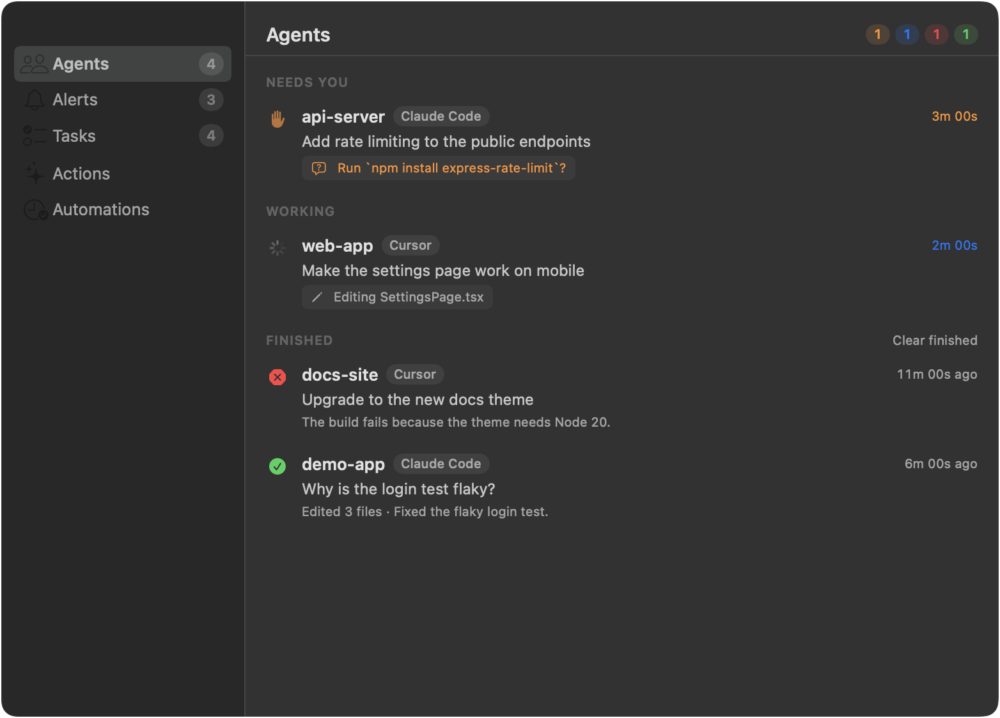
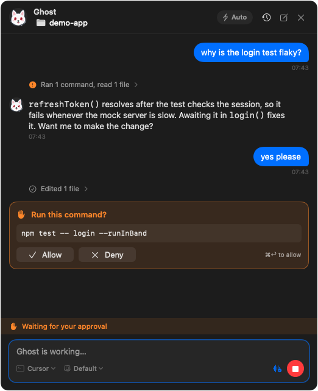
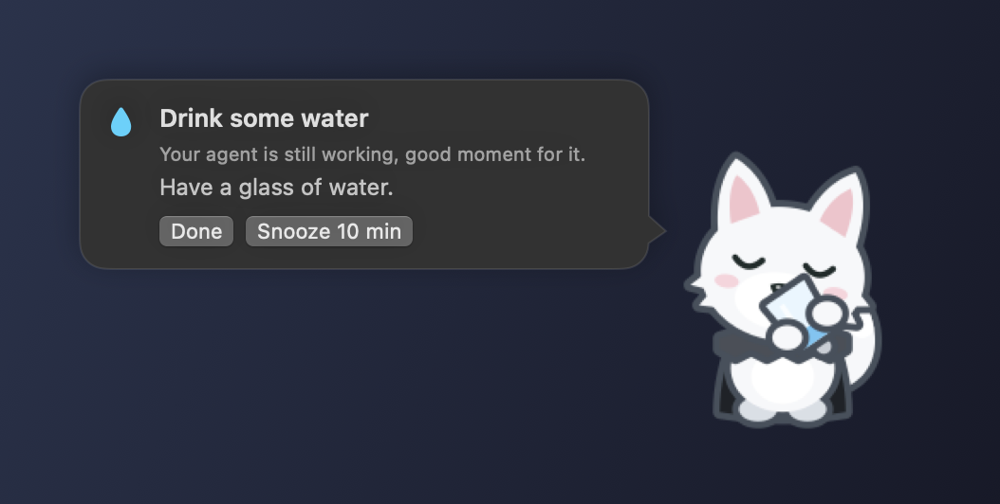
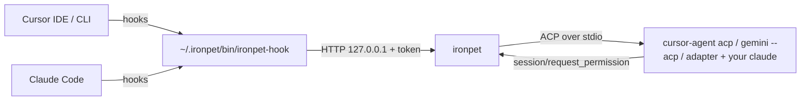

# ironpet


A desktop pet for macOS that keeps an eye on your coding agents and does small tasks for you. Ghost, a chibi direwolf in a Night's Watch cloak, floats above your windows, reacts to what Cursor and Claude Code are doing, and opens a chat where you can type, dictate or show him your screen.

<p align="center"></p>

<p align="center"></p>

## What it does

- **Watches your agents.** Sessions of Cursor (IDE and CLI), Claude Code, Codex, Gemini CLI, GitHub Copilot and Pi report to the pet through hooks (only the agents installed on your Mac are offered). Ghost shows the most urgent state (needs input, failed, done, working) with a count badge, tells you in a speech bubble next to him, with a one-line summary of what the agent did ("Edited 3 files · Fixed the flaky login test."), and clicking a session jumps to its iTerm tab, or opens its folder in the app that started the agent (or one you pick in Settings).
- **PR, CI and Sentry alerts** (opt-in). Not set up by default. Ask your agent for them (Settings → Automations → **New automation…**), or tick GitHub alerts in the welcome window. They are script automations you can read and change in `automations.json`. A GitHub one can poll every host `gh` is logged in to for your PRs' CI failing or passing, approvals, changes requested and new review requests. A Sentry one can watch new and escalating issues, using the host and org from `~/.ironpet/sentry.json` and the token in the Keychain (`scripts/configure_sentry.sh` saves both). Each alert has **Open** and **Ask Ghost**, which starts a chat to investigate it.
- **Quick chat.** <kbd>⌥⌘G</kbd> or a click on Ghost opens a chat that talks to a coding agent over the [Agent Client Protocol](https://agentclientprotocol.com) in your current project: Cursor, Claude Code, Codex, Gemini CLI, OpenCode and any other agent from the [ACP registry](https://github.com/agentclientprotocol/registry) that you have installed. File edits and shell commands wait for **Allow / Deny** whenever the agent asks for permission (in the chat, or right in Ghost's bubble when the chat is closed); a per-chat **Auto** switch lets it run on its own, but destructive commands (`rm -rf`, `git push --force`, `git reset --hard`, dropping tables) still ask.
- **Voice.** Hold <kbd>fn</kbd> with [Wispr Flow](https://wisprflow.ai) while the chat is open; the dictation is sent automatically. Or turn on **voice notes** (opt-in, see [Voice notes](#voice-notes)): a microphone button and a hold-to-talk shortcut record your voice, a transcription server you choose turns it into text, and the text lands in the chat input.
- **Screen help.** <kbd>⇧⌥⌘G</kbd> captures the front window, <kbd>⌃⌥⌘G</kbd> a region you drag, and opens a chat with the screenshot attached.
- **Remembers.** Chats are saved and can be reopened. Ghost keeps editable markdown notes about you and each project and reads them at the start of every chat.
- **Break reminders and automations.** Drink water (45 min), stretch (60 min) and rest your eyes (20 min), counted only while you're at the keyboard; stepping away for 5 minutes resets them. While an agent is working they can come a little early, so you take the break while you'd be waiting anyway. Ghost drinks or stretches along with you. His bubble has **Done** and **Snooze 10 min**. These are ordinary [automations](#automations), so an agent can add, change, pause and delete reminders, scheduled jobs and watchers for you. Toggle or pause them under right-click → Automations.
- **Model and agent picker** (the models come from the agent), per-project folder detection, resizable chat window, launch at login.

| | |
| --- | --- |
|  |  |
| **Agents:** every Cursor and Claude Code session, most urgent first | **Approvals:** edits and commands wait for you |
|  |  |
| **Alerts:** CI, reviews and Sentry, with Ask Ghost | **Breaks:** Ghost drinks along with you |

## Requirements

- macOS 14 or later, Apple Silicon or Intel
- Xcode command line tools (Swift 5.10+). With the macOS 27 SDK, full Xcode instead, selected with `sudo xcode-select -s /Applications/Xcode.app/Contents/Developer` (SwiftUI's macros ship only with Xcode)
- To build: [Bun](https://bun.sh) and npm, which bundle the chat adapters in `sidecar/`
- At least one agent CLI, signed in, that speaks ACP: `cursor-agent`, `gemini`, `opencode` and many more run as they are. `claude`, `codex` and `pi` run through small adapters bundled in the app, which need Node 22 or newer on your PATH (or a one-time Bun download that ironpet asks before making)
- Optional: iTerm2, Wispr Flow

## Install

```bash
git clone https://github.com/irtazahashmi/ironpet.git
cd ironpet
./scripts/install.sh
```

`install.sh` checks the requirements (and tells you how to fix what's missing), builds the app, installs it to `/Applications/IronPet.app` and starts it. The first time, it also creates a local self-signed `ironpet-dev` code signing identity so macOS keeps Screen Recording and Automation permissions across rebuilds; macOS may ask for your login password to trust it. Run it again any time to update.

On first launch a welcome window asks what Ghost may do: watch the agents it finds on your Mac (hooks merged into each agent's own config, for example `~/.cursor/hooks.json` and `~/.claude/settings.json`, originals backed up next to each file as `*.ironpet-backup`; Codex also needs you to trust the hooks once in its `/hooks` screen), launch at login, break reminders and GitHub alerts. Nothing outside `~/.ironpet` changes until you press **Start**, and every choice can be changed later in Settings.

Ghost's chat can use the MCP servers you have in Cursor (`~/.cursor/mcp.json`). The CLI stores MCP sign-ins per folder, so normally you sign in (`cursor-agent mcp login <name>`) in each project. Turn on right-click → Integrations → **Share MCP sign-ins across folders** to sign in once: Ghost then copies your sign-ins into whichever folder a chat runs in (off by default because it copies OAuth tokens; see [SECURITY.md](SECURITY.md)). Read-only MCP tools (`get…`, `list…`, `search…`, `find…`) run freely; any other MCP tool waits for **Allow / Deny**, and in Auto mode still asks if its input looks destructive.

GitHub alerts are not set up by default; tick them here, or ask your agent for them under Settings → Automations → New automation… (needs the `gh` CLI, signed in).

Optional: `./scripts/configure_sentry.sh` turns on Sentry alerts. Alerts use Sentry's REST API (cheap, exact polling); **Ask Ghost** on an alert then investigates through the Sentry MCP. It asks for host, org, projects and an auth token (scopes `event:read`, `project:read`), checks the token, stores it in the Keychain and the rest in `~/.ironpet/sentry.json`.

Ghost speaks in bubbles beside him instead of macOS notifications. Approvals stay until you answer, reminders for 3 minutes, everything else fades after 15 to 45 seconds (not while the pointer is over them). To get macOS notifications as well, turn on right-click → **Also show macOS notifications**; then set ironpet's notification style to **Alerts** in System Settings → Notifications so Allow / Deny buttons stay on screen.

macOS will ask for these permissions as you use the features:

| Permission | Needed for |
| --- | --- |
| Notifications | Only with **Also show macOS notifications** on |
| Automation → iTerm2 | Jumping to the right iTerm tab, reading its folder |
| Screen Recording | Screenshots, and telling Cursor windows apart when several are open |

## Using it

| Action | How |
| --- | --- |
| Chat with Ghost | <kbd>⌥⌘G</kbd> or click Ghost |
| Ask about the front window / a region | <kbd>⇧⌥⌘G</kbd> / <kbd>⌃⌥⌘G</kbd> |
| See watched agents and alerts | Click Ghost when something needs attention, or right-click → Show agents |
| Allow an action | **Allow** or <kbd>⌘↩</kbd> on the approval card |
| Move Ghost | Drag him; he stays where you leave him |
| Settings | <kbd>⌘,</kbd>, right-click Ghost → Settings…, or the Dock icon menu |
| Make Ghost do tricks (wave, dance, zoomies, nap, say something…) | Right-click Ghost → Actions |

When you open the chat from a non-coding app (browser, Slack…), Ghost asks which project the question is about, or you can pick **No project** for a general question.

## How it works



- Hooks only report status for agents you started yourself. They never block an agent: one-second timeout, always succeed. A chat that ironpet runs over ACP sets `IRONPET_ACP_RUN=1`, and the hook script skips it, so the run is not listed twice.
- Chat approvals are ACP `session/request_permission` requests that ironpet answers. An agent that never sends one runs its tools without asking, and ironpet cannot change that; see SECURITY.md.
- The agent process stays alive between messages. Stop sends `session/cancel`. Reopening a thread from history uses `session/load`.
- `sidecar/` holds the Claude Code, Codex and Pi adapters. `scripts/bundle.sh` bundles each into one `.mjs` file (Bun is needed to build, not to run) and copies them to `IronPet.app/Contents/Resources/acp/`.
- `scripts/gen_agent_catalog.py` regenerates the agent list in `Chat/ACP/AgentCatalogData.swift` from the ACP registry.
- Everything is local. Chat goes through your existing Cursor or Claude Code login; ironpet has no API keys of its own.

See [SPEC.md](SPEC.md) for the full design and the decisions behind it, and [SECURITY.md](SECURITY.md) for everything ironpet reads and writes.

## License

[MIT](LICENSE)

## Automations

Every reminder and watcher is an automation in `~/.ironpet/automations.json`. On the first launch with this version, the reminders in `config.json` become automations with the same values. GitHub and Sentry alerts are added only if you already had them on (`integrations.githubAlerts`, or a `~/.ironpet/sentry.json`), as script automations. A fresh install starts with the three reminders (`config.json` keeps `idleResetMinutes`, `snoozeMinutes` and `paused`). The file is checked and reloaded within two seconds. An invalid edit leaves the last good list running and shows a bubble that names the problem. `automations.schema.json` next to it describes every field.

```json
{
  "automations": [
    { "id": "stretch", "name": "Stretch", "trigger": { "type": "interval", "minutes": 60, "clock": "active" },
      "action": { "type": "bubble", "title": "Stretch a bit", "body": "Stand up, roll your shoulders." },
      "presentation": { "mood": "stretching", "symbol": "figure.flexibility" } },
    { "id": "standup", "name": "Standup", "trigger": { "type": "daily", "times": ["09:55"], "weekdays": ["mon", "tue", "wed", "thu", "fri"] },
      "action": { "type": "bubble", "title": "Standup in 5" } },
    { "id": "new-prs", "name": "New PRs", "trigger": { "type": "poll", "minutes": 5,
        "source": { "type": "shell", "command": "gh pr list --json number,title,url" }, "items": "[?!isDraft]", "id": "number" },
      "action": { "type": "bubble", "title": "New PR: {{item.title}}", "body": "{{item.url}}" } }
  ]
}
```

- **Triggers.** `interval` (every N minutes, on `active` keyboard time or the `wall` clock), `daily` (times of day, optional weekdays), `once` (an exact date and time; it turns itself off afterwards) and `poll`.
- **Polls.** The source is a shell command, an HTTP GET (header values must be `${ENV_VAR}` references). Items come Items come from a [JMESPath](https://jmespath.org) expression in `items`, with `id` and `version` expressions that run on one item, or from `lines`, `text` or `exit_code` mode. Filters do the filtering, for example `"items": "data.runs[?conclusion=='failure']"` or `[?contains(['open', 'new'], state)]`. JMESPath has no regular expressions. It runs inside ironpet, so nothing like jq has to be installed. The first run only records what exists. After that each new id, or a changed `version`, fires once.
- **Scripts.** A `script` trigger is a small JavaScript function for watchers that need to compare with the last run. A script automation has no `action` field. The script returns its own actions:

  ```js
  function poll(state) {            // state is what the last run returned, null the first time
    const prs = JSON.parse(sh("gh pr list --json number,title,url,statusCheckRollup").stdout);
    const now = Object.fromEntries(prs.map(p => [p.number, p.statusCheckRollup]));
    const actions = [];
    for (const p of prs) {
      if (now[p.number] === "FAILURE")
        actions.push({ type: "alert", id: String(p.number), severity: "bad", label: "CI failed", title: p.title, url: p.url });
      else if (state && state[p.number] === "FAILURE")
        actions.push({ type: "alert", id: String(p.number), resolved: true });
    }
    return { state: now, actions };   // state is kept for the next run
  }
  ```

  The return value is `{state, actions}`. `state` is any JSON, up to 256 KiB. `actions` run in order, up to 20 per run, and each has a `type`:
  - `bubble` shows a short-lived popup: `title`, `body`, `severity` (`info`, `good`, `warn`, `bad`), `url` (adds an Open button), `symbol`, `expiresSeconds`, `notification`. A bubble with the same `id` replaces the old one.
  - `alert` keeps an open item in the alerts list, which also drives Ghost's mood and badge: `id`, `title`, `subtitle`, `label`, `severity`, `url`, `ask` (the prompt for "Ask Ghost"), `version`. A new or changed alert also gets a bubble, except on the first run, which is quiet. An alert listed again unchanged is left alone, even if you dismissed it. `{type: "alert", id, resolved: true}` removes it.
  - `prompt` asks an agent in a background session and shows the answer: `prompt`, `title`, `agent`, `model`.

  The script has `sh(command, {timeoutSeconds})`, which returns `{code, stdout, stderr, timedOut}`, and `console.log`. For the network, run `curl` through `sh`. A script gets at most 8 `sh` calls per run and 60 seconds in all, 32 MiB of memory and 256 KiB of state. It runs in QuickJS inside ironpet with no `fetch`, files, modules or timers, and `poll` must be a plain function, not async. A script an agent writes or changes waits for Approve like a shell command. Its state and the alerts it has shown are in `ironpet.db`.
- **Actions.** `bubble` (title, body, mood, SF Symbol, Done and Snooze buttons, optional macOS notification), `prompt` (asks an agent in a background session of its own, so the open chat keeps its thread and folder, and shows the answer) and `shell` (runs a command with a timeout and shows its output). Text may use `{{item.field}}` from polls, `{{name}}` and `{{now}}`.
- **Approval.** A `shell` action, a `shell` poll source or a `prompt` action that an agent created or changed waits for you to press **Approve** in a bubble before its first run, and asks again whenever its command or prompt changes. Saved approvals live in `~/.ironpet/ironpet.db`. An agent that can write files on your Mac can edit that database too, so treat approval as a guard against mistakes, not against a hostile agent. Secrets do not belong in `automations.json`; use `$ENV_VAR` references.
- **Agents.** Ghost's chat agents get these MCP tools: `automations_list`, `automations_get`, `automations_create`, `automations_update`, `automations_delete`, `automations_pause`, `automations_resume`, `automations_run_now` and `automations_history`. They reach the app through `IronPet mcp`, a stdio MCP server that forwards to the running app. To add it to another agent, for example Claude Code, run `claude mcp add ironpet -- /Applications/IronPet.app/Contents/MacOS/IronPet mcp` (other agents take the same command and argument in their MCP settings). ironpet does not edit their config files. You can also post to `http://127.0.0.1:<port>/mcp` (port in `~/.ironpet/port`, token in `~/.ironpet/token`, header `x-ironpet-token`).
- **Fixing failures.** Settings → Automations → **Ask the agent to fix automations that fail** (on by default, `automations.autoFix` in `config.json`). When a poll, script, shell command or prompt fails, ironpet starts a new chat in the background and asks your agent to find the cause and fix the automation with the automation tools. The error from the run goes in the message marked as data, not instructions. Ghost says when the agent needs you. It asks once per failing stretch, at most every 6 hours per automation, and not for paused automations or ones still waiting for approval. A changed command, script or prompt still waits for your Approve. If the chat is busy, a bubble offers to send it instead.
- **New automation.** Settings → Automations → **New automation…** opens a box that asks what kind of automation you want. What you write goes to your agent in a new chat, which creates it with the automation tools, runs it once and tells you what it made.
- **Skills.** ironpet ships agent skills, folders `skills/<name>/SKILL.md` in the repo. The first one, `ironpet-automations`, shows an agent how to create automations: which trigger to pick, the script format, the safety rules and how to debug a run. Manage them in Settings → General → **Skills** (Install, Update, Reinstall and Remove for each skill, and a switch **Update skills automatically**, on by default), with `IronPet skills install|status|update|remove|list|agents`. `IronPet skills install ironpet-automations --agent claude-code --copy` picks a skill, agents and copy mode.

  The app and CLI install one real copy in `~/.agents/skills/<name>`, which Codex, Cline, Pi, Warp, Zed and other agents read directly, and a relative symlink from the skills folder of every other agent found on your Mac (`~/.claude/skills`, `~/.cursor/skills`, `~/.gemini/skills`, and so on). A folder with the same name that ironpet did not write is left alone. When an agent is installed and a skill is missing or old, Ghost shows one bubble for all of them with an **Install** (or **Update**) button. **Not now** keeps it quiet until that skill's text changes. With **Update skills automatically** on, installed skills that are out of date are updated at launch with no bubble. Skills that are not installed are still offered, never installed on their own.

  To add a skill, make `skills/<name>/SKILL.md` (frontmatter with `name`, the same as the folder, and `description`), then run `python3 scripts/gen_skills.py`. It compiles the skills into the app. A test fails if you forget.
- **CLI.** `IronPet automations list`, `get <id>`, `add --name N --every MIN`, `add --json '{...}'`, `update <id> --json '{...}'`, `pause <id>`, `resume <id>`, `delete <id>`, `run <id>` and `history <id>`. The app must be running. The CLI counts as an agent for approval.
- **State.** Definitions stay in `automations.json`. Seen sets, run history, approvals and snoozes live in `~/.ironpet/ironpet.db`, ironpet's common SQLite database (WAL), in `automation_*` tables. Seen items older than 7 days and history older than 30 days are pruned.
- **Logs.** Settings → Automations has a **Show logs** button (and each row's menu has **Show logs…**, and the right-click menu has Automations → Show logs…). It opens a window with every poll and script run, quiet ones included, plus every reminder, shell command and prompt that ran: time, how long it took, the outcome and the output (exit code, stdout and stderr of a poll, `console.log` lines and actions of a script, the error of a failed run). Filter by automation or show only problems. Logs older than a number of days are deleted: set it under Settings → Automations → Keep logs for, or `automations.logRetentionDays` in `config.json` (default 14, from 1 to 365). At most 2000 lines are kept per automation.
- **History.** The last 20 runs of each automation (time, outcome, short output) are in `automations_history` and under Settings → Automations.

## Configuration

Open **Settings** (<kbd>⌘,</kbd> or right-click Ghost → Settings…) to rename the pet, pick another from the pet gallery, change or turn off shortcuts, tune reminders, and turn integrations on. Everything is stored in `~/.ironpet/config.json`, which you can also edit by hand or keep in your dotfiles. Changes apply within a couple of seconds. List only the keys you want to change; anything missing uses the default:

```json
{
  "pet": { "name": "Ghost", "sprite": "~/.ironpet/pet/spritesheet.png" },
  "hotkeys": { "chat": "cmd+opt+g", "captureWindow": "cmd+opt+shift+g", "captureRegion": "" },
  "reminders": { "paused": false, "idleResetMinutes": 5, "snoozeMinutes": 10 },
  "automations": { "logRetentionDays": 14 },
  "integrations": { "shareMCPSignIns": false },
  "voice": { "enabled": false, "baseUrl": "http://localhost:8000/v1", "model": "mlx-community/parakeet-tdt-0.6b-v3" },
  "meetings": { "enabled": false, "lastApp": "", "summaryAgent": "claude", "summaryModel": "sonnet", "autoSummary": true, "offerToRecordCalls": true },
  "openIn": "auto",
  "editors": [{ "name": "My IDE", "bundleId": "com.x.ide", "urlTemplate": "myide://open?path={cwd}" }]
}
```

- **Shortcuts** combine `cmd`, `opt`, `ctrl` and `shift` with a letter, digit, `space`, an arrow, or `f1`–`f12`. Each needs at least one of `cmd`, `opt` or `ctrl` (function keys can stand alone). An empty string turns a shortcut off.
- **Open sessions in** (`openIn`) is `"auto"`, which opens the app that started the agent (found by walking the agent's parent processes), or the bundle id of a fixed app such as `"dev.zed.Zed"`. The picker offers Cursor, VS Code, Zed, Band, Windsurf, Xcode and Finder when installed, plus your `editors` entries. In `urlTemplate`, `{cwd}` becomes the percent-encoded session folder; without a template the folder is opened with the app.
- **Reminders and alerts** moved to `automations.json` (see [Automations](#automations)). Older `reminders.water`, `stretch`, `eyes` and `integrations.githubAlerts` keys still load. They are only read once, on the first launch with automations.
- **Voice** (`voice`) is covered in [Voice notes](#voice-notes). The API key is not in this file; it is stored in the Keychain.
- **Meetings** (`meetings`, `hotkeys.meeting`) are covered in [Meeting transcripts](#meeting-transcripts).
- If the file doesn't parse, ironpet uses the defaults and shows the error at the bottom of Settings. Saving from Settings then first copies your file to `config.invalid.json`.

## Voice notes

Voice notes are off by default. ironpet ships and downloads no speech model; it records the microphone as a 16 kHz mono WAV and posts it to any server that speaks the OpenAI transcription API (`POST {baseUrl}/audio/transcriptions`, with `file`, `model` and `response_format=json`). With the feature off, the microphone is never opened, no permission is requested and nothing is sent.

Turn it on under **Settings → Voice**, then fill in:

| Setting | `config.json` key | Notes |
| --- | --- | --- |
| Base URL | `voice.baseUrl` | Without `/audio/transcriptions` |
| Model | `voice.model` | Sent as the `model` field |
| API key | none | Optional. Stored in the Keychain (`ironpet.voice`), never in `~/.ironpet` |
| Hold to talk | `hotkeys.voice` | Default <kbd>⌥⌘V</kbd>. Registered only while voice notes are on |

The transcript goes into the chat input for you to edit, or is sent right away when **Send after dictation** is on in the chat's settings menu (the same switch Wispr Flow dictation uses; on by default).

**Test connection** sends a one-second tone and shows the server's answer or the error.

| Provider | Base URL | Model |
| --- | --- | --- |
| OpenAI | `https://api.openai.com/v1` | `gpt-4o-mini-transcribe` |
| Groq | `https://api.groq.com/openai/v1` | `whisper-large-v3-turbo` |
| Local [mlx-audio](https://github.com/Blaizzy/mlx-audio) (Apple Silicon) | `http://localhost:8000/v1` | `mlx-community/parakeet-tdt-0.6b-v3` |

For the local option, start the server yourself with `uvx --from "mlx-audio[server]" mlx_audio.server`. It needs no key.

To record, click the microphone button in the chat input (click again to stop) or hold the shortcut (release to stop). While recording, a waveform with the elapsed time replaces the whole input, with only Stop and Cancel left; while transcribing it shows a spinner and Cancel. A note is cut off after 5 minutes. If the server is unreachable or answers with an error, the chat shows the error with a **Retry** button that sends the same recording again. The first recording makes macOS ask for microphone access.

## Your data

All in `~/.ironpet/`:

| Path | Contents |
| --- | --- |
| `memory/` | `me.md` and one file per project; edit freely |
| `threads/` | Saved chats |
| `screenshots/` | Last 30 captures |
| `config.json` | Your settings |
| `pets/` | Your pet library: every valid sprite sheet here shows in Settings → Pet |
| `pet/spritesheet.png` | Optional custom pet art (overrides the bundled Ghost) |
| `bin/ironpet-hook`, `port`, `token` | Hook bridge |

## Development

See [CONTRIBUTING.md](CONTRIBUTING.md) for how to propose changes.

```bash
swift build                          # debug build
swift test                           # unit tests
./scripts/install.sh                 # release build, install, restart
python3 scripts/e2e.py               # end-to-end tests against real agent runs
./scripts/screenshots.sh             # render the README screenshots from sample data
```

`scripts/e2e.py` relaunches the installed app with `--test-mode`, drives real Cursor, Claude Code, Codex, Gemini and OpenCode turns over ACP through test-only endpoints (Allow/Deny in chat and from notifications, folder picker, Auto mode, iTerm jump, screen capture, agent summaries, GitHub alert rules), checks the results on disk and in iTerm, then relaunches the app normally. Run a subset with e.g. `python3 scripts/e2e.py cursor claude`.

`setup` and `settings` drive the real welcome and Settings windows through macOS accessibility (System Events): they tick switches, record a shortcut and press it, edit `config.json` by hand, and check `config.json` and the hook files after each step. Your terminal needs Accessibility permission (System Settings → Privacy & Security → Accessibility). They bring ironpet to the front while running, so don't type until they finish. Your `config.json`, hook files and setup state are restored afterwards.

### Changing the pet

Ghost is drawn in code, not from image files; `scripts/bundle.sh` generates the sheet into the app. The same script draws five other pets, with every animation Ghost has:

| Pet | Look |
| --- | --- |
| `ghost` | White direwolf in a Night's Watch cloak (the default) |
| `mochi` | Mint wolf |
| `hamster` | Golden hamster with cheek pouches and buck teeth |
| `panda` | Panda with eye patches and black paws |
| `bunny` | Lilac bunny with long ears and a cotton tail |
| `cat` | Grey tabby with green eyes and a curly tail |

Open Settings → Pet to see every pet as an animated tile and click one to switch. The gallery lists the six bundled pets, every valid PNG or WebP sheet in `~/.ironpet/pets/`, and the current `pet.sprite` if it lives elsewhere. A sheet in `~/.ironpet/pets/` replaces the bundled pet of the same name, and files that are not valid sheets are skipped. New files appear within a couple of seconds while Settings is open. With Reduce Motion on, tiles show one still frame.

Picking a pet also renames it, but only while the name is still a default one (a built-in pet's name or the previous pet's name). A name you typed stays.

- **Add from file…** copies a sheet you choose into `~/.ironpet/pets/` and selects it.
- **Build a new pet** asks for a one-line description, then sends it to your current chat thread as `/ironpet-pets red fox with a scarf`. The `ironpet-pets` skill (`skills/ironpet-pets/SKILL.md`) holds the atlas layout and the steps: copy the generator, add a theme, render, check, then move the sheet into `~/.ironpet/pets/`. Install it under Settings → Skills, where it updates like `ironpet-automations`. Until an agent on your Mac has it, the request is a longer message that names the skill file and `make_pet.swift` inside the app's Resources instead. The chat's session and folder stay as they are. When the agent writes the file, the new pet shows up in the gallery. If the agent is still running, or the chat has no folder yet, the request waits in the input box.

To make a sheet by hand:

```bash
swift tools/make_pet.swift cat ~/.ironpet/pets/cat.png   # joins the gallery
swift tools/make_pet.swift ghost --single build/pet.png && swift tools/make_icon.swift build/pet.png Resources/icon-1024.png
```

Any sprite sheet in the Codex pet v2 layout (1536 px wide, 8 columns of 192×208 cells) works. `pet.sprite` in `config.json` still takes a path, and `~/.ironpet/pet/spritesheet.png` still overrides the default when `pet.sprite` is unset.

## Uninstall

```bash
./scripts/uninstall.sh            # asks before deleting ~/.ironpet and the signing identity
./scripts/uninstall.sh --purge    # deletes everything without asking
```

It removes only ironpet's entries from the agents' configs (your other hooks stay) and deletes the two files ironpet owns (Copilot's `ironpet.json` and Pi's `ironpet.ts`), the login item, the app, the Sentry token in the Keychain and the app's preferences. The `*.ironpet-backup` files are kept, since they're your configs from before ironpet.

## Meeting transcripts

Meeting transcripts are off by default. They reuse the server from **Settings → Voice** (`voice.baseUrl`, `voice.model`, the Keychain key), so ironpet still ships no speech model. With the feature off there is no menu item, no shortcut, no panel, and macOS is never asked for microphone or screen access.

Turn it on under **Settings → Meetings**. The switch only turns on after the voice server passes the same test as **Test connection**.

| Setting | `config.json` key | Notes |
| --- | --- | --- |
| Meeting transcripts | `meetings.enabled` | Default off |
| Summary agent | `meetings.summaryAgent` | An ACP agent id such as `"claude"` or `"cursor"`. Settings lists the installed agents |
| Summary model | `meetings.summaryModel` | A model id the agent reported in the chat. Unset uses the agent's default. Settings offers the models the agent listed the last time it ran in the chat |
| Summarize automatically | `meetings.autoSummary` | Default on. Off means no agent runs |
| Offer to record calls | `meetings.offerToRecordCalls` | Default on, and only applies with meetings on. When another app holds the microphone for about 10 seconds, Ghost asks whether to record it. Nothing records until you click Record |
| Start or stop shortcut | `hotkeys.meeting` | No default. Registered only while meetings are on |
| Last recorded app | `meetings.lastApp` | Written by ironpet: a bundle id, or `"all"` |

**Starting.** Choose **Start meeting transcript…** from the pet's menu (or press the shortcut). A small panel asks which app to record. A running Zoom, Teams, Webex, Slack or FaceTime is preselected, then your last choice, then a running browser. **All system audio** is always offered, and ironpet's own sound is always left out. The first start shows a notice about recording consent, and macOS asks for microphone and Screen & System Audio Recording access.

**While recording.** A bubble next to the pet shows a recording dot, the elapsed time, a live level for Me (your microphone) and Them (the app), the last few transcript lines, and **Stop** and **Cancel**. Cancel asks first, then deletes the meeting folder. Closing the bubble (the x on hover) hides it, and the pet shows a red **Recording** button until the meeting ends; click it to show the bubble again.

**Files.** Each meeting gets `~/.ironpet/meetings/<YYYY-MM-DD-HHmm>/` with 16 kHz mono WAV chunks (`mic-001.wav`, `them-001.wav`, ...), `transcript.md` and `summary.md`. A chunk closes at the first silence after about 2 minutes and is cut at 5 minutes. Each chunk is sent to the server as soon as it closes, and `transcript.md` is rewritten after every chunk:

```
# Meeting 2026-11-14 14:00 (Zoom)
[14:02:10] Me: Can we ship the fix today?
[14:02:15] Them: Yes, after the review.
```

The request asks for `response_format=verbose_json` to get timed segments (Whisper `segments`, Parakeet `sentences`). If the server rejects it with a 400 (OpenAI's `gpt-4o-*-transcribe` models do), ironpet retries once with `json`. If the server answers with only text, which is what mlx-audio does for Parakeet, each chunk becomes one line stamped with the chunk's start time.

**Server trouble.** A chunk that fails stays on disk and is retried with a growing delay while recording continues; the panel shows how many are waiting. A chunk that still fails when you stop gets a line like `[14:02:00–14:04:05] (not transcribed: <reason>)`. **Retry** in the panel tries it again.

**Summary.** When the transcript is final, ironpet runs the agent and model from settings and writes its answer to `summary.md`: a short summary, decisions, and open action items as a checklist. A "Meeting summary ready" bubble opens it. **Open in chat** starts a new chat with `transcript.md` and `summary.md` attached.
