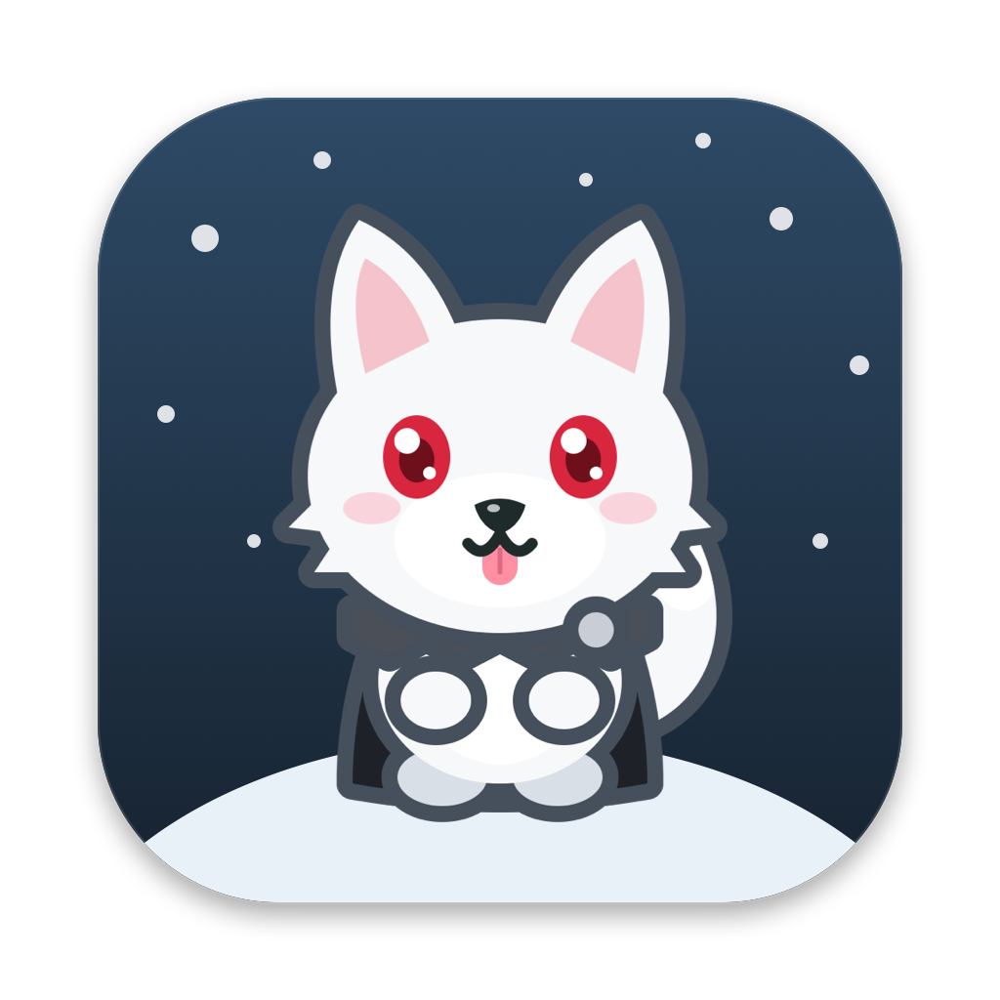
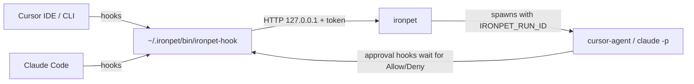

# ironpet



A desktop pet for macOS that keeps an eye on your coding agents and does small tasks for you. Ghost, a chibi direwolf in a Night's Watch cloak, floats above your windows, reacts to what Cursor and Claude Code are doing, and opens a chat where you can type, dictate or show him your screen.

## What it does

- **Watches your agents.** Cursor (IDE and CLI) and Claude Code sessions report to the pet through hooks. Ghost shows the most urgent state (needs input, failed, done, working) with a count badge, tells you in a speech bubble next to him, with a one-line summary of what the agent did ("Edited 3 files · Fixed the flaky login test."), and clicking a session jumps to its iTerm tab or Cursor window.
- **PR, CI and Sentry alerts** (opt-in). With GitHub alerts on, Ghost polls every GitHub host `gh` is logged in to: your PRs' CI failing or passing, approvals, changes requested, and new review requests. With Sentry configured, new and escalating issues too. Each alert has **Open** and **Ask Ghost**, which starts a chat to investigate it.
- **Quick chat.** <kbd>⌥⌘G</kbd> or a click on Ghost opens a chat that runs headless [cursor-agent](https://cursor.com/cli) or [Claude Code](https://docs.anthropic.com/claude-code) in your current project. Every file edit and shell command waits for **Allow / Deny** (in the chat, or right in Ghost's bubble when the chat is closed); a per-chat **Auto** switch lets it run on its own, but destructive commands (`rm -rf`, `git push --force`, `git reset --hard`, dropping tables) still ask.
- **Voice.** Hold <kbd>fn</kbd> with [Wispr Flow](https://wisprflow.ai) while the chat is open; the dictation is sent automatically.
- **Screen help.** <kbd>⇧⌥⌘G</kbd> captures the front window, <kbd>⌃⌥⌘G</kbd> a region you drag, and opens a chat with the screenshot attached.
- **Remembers.** Chats are saved and can be reopened. Ghost keeps editable markdown notes about you and each project and reads them at the start of every chat.
- **Break reminders.** Drink water (45 min), stretch (60 min) and rest your eyes (20 min), counted only while you're at the keyboard; stepping away for 5 minutes resets them. While an agent is working they can come a little early, so you take the break while you'd be waiting anyway. Ghost drinks or stretches along with you. His bubble has **Done** and **Snooze 10 min**; toggle or pause them under right-click → Reminders.
- **Model and backend picker**, per-project folder detection, resizable chat window, launch at login.

## Requirements

- macOS 14 or later, Apple Silicon or Intel
- Xcode command line tools (Swift 5.10+)
- At least one agent CLI, signed in: `cursor-agent` (`~/.local/bin`) and/or `claude`
- Optional: iTerm2, Wispr Flow

## Install

```bash
git clone https://github.com/irtazahashmi/ironpet.git
cd ironpet
./scripts/install.sh
```

`install.sh` checks the requirements (and tells you how to fix what's missing), builds the app, installs it to `/Applications/IronPet.app` and starts it. The first time, it also creates a local self-signed `ironpet-dev` code signing identity so macOS keeps Screen Recording and Automation permissions across rebuilds; macOS may ask for your login password to trust it. Run it again any time to update.

On first launch a welcome window asks what Ghost may do: watch Cursor and/or Claude Code (hooks merged into `~/.cursor/hooks.json` and `~/.claude/settings.json`, originals backed up next to each file as `*.ironpet-backup`), launch at login, break reminders and GitHub alerts. Nothing outside `~/.ironpet` changes until you press **Start**, and every choice can be changed later in Settings.

Ghost's chat can use the MCP servers you have in Cursor (`~/.cursor/mcp.json`). The CLI stores MCP sign-ins per folder, so normally you sign in (`cursor-agent mcp login <name>`) in each project. Turn on right-click → Integrations → **Share MCP sign-ins across folders** to sign in once: Ghost then copies your sign-ins into whichever folder a chat runs in (off by default because it copies OAuth tokens; see [SECURITY.md](SECURITY.md)). Read-only MCP tools (`get…`, `list…`, `search…`, `find…`) run freely; any other MCP tool waits for **Allow / Deny**, and in Auto mode still asks if its input looks destructive.

GitHub alerts are off by default; turn them on under right-click → Integrations (needs the `gh` CLI, signed in).

Optional: `./scripts/configure_sentry.sh` turns on Sentry alerts. Alerts use Sentry's REST API (cheap, exact polling); **Ask Ghost** on an alert then investigates through the Sentry MCP. It asks for host, org, projects and an auth token (scopes `event:read`, `project:read`), checks the token, stores it in the Keychain and the rest in `~/.ironpet/sentry.json`.

Ghost speaks in bubbles beside him instead of macOS notifications. Approvals stay until you answer, reminders for 3 minutes, everything else fades after 15 to 45 seconds (not while the pointer is over them). To get macOS notifications as well, turn on right-click → **Also show macOS notifications**; then set ironpet's notification style to **Alerts** in System Settings → Notifications so Allow / Deny buttons stay on screen.

macOS will ask for these permissions as you use the features:

| Permission | Needed for |
| --- | --- |
| Notifications | Only with **Also show macOS notifications** on |
| Automation → iTerm2 | Jumping to the right iTerm tab, reading its folder |
| Screen Recording | Screenshots, and telling Cursor windows apart when several are open |

## Using it

| Action | How |
| --- | --- |
| Chat with Ghost | <kbd>⌥⌘G</kbd> or click Ghost |
| Ask about the front window / a region | <kbd>⇧⌥⌘G</kbd> / <kbd>⌃⌥⌘G</kbd> |
| See watched agents and alerts | Click Ghost when something needs attention, or right-click → Show agents |
| Allow an action | **Allow** or <kbd>⌘↩</kbd> on the approval card |
| Move Ghost | Drag him; he stays where you leave him |
| Settings | <kbd>⌘,</kbd>, right-click Ghost → Settings…, or the Dock icon menu |
| Make Ghost do tricks (wave, dance, zoomies, nap, say something…) | Right-click Ghost → Actions |

When you open the chat from a non-coding app (browser, Slack…), Ghost asks which project the question is about, or you can pick **No project** for a general question.

## How it works



- Status hooks never block an agent: one-second timeout, always succeed.
- Approval hooks act only for agents ironpet started (they carry `IRONPET_RUN_ID`) and return immediately for everything else.
- Everything is local. Chat goes through your existing Cursor or Claude Code login; ironpet has no API keys of its own.

See [SPEC.md](SPEC.md) for the full design and the decisions behind it, and [SECURITY.md](SECURITY.md) for everything ironpet reads and writes.

## License

[MIT](LICENSE)

## Configuration

Open **Settings** (<kbd>⌘,</kbd> or right-click Ghost → Settings…) to rename the pet, swap its sprite sheet, change or turn off shortcuts, tune reminders, and turn integrations on. Everything is stored in `~/.ironpet/config.json`, which you can also edit by hand or keep in your dotfiles. Changes apply within a couple of seconds. List only the keys you want to change; anything missing uses the default:

```json
{
  "pet": { "name": "Ghost", "sprite": "~/.ironpet/pet/spritesheet.png" },
  "hotkeys": { "chat": "cmd+opt+g", "captureWindow": "cmd+opt+shift+g", "captureRegion": "" },
  "reminders": {
    "paused": false,
    "water": { "enabled": true, "minutes": 45 },
    "stretch": { "enabled": true, "minutes": 60 },
    "eyes": { "enabled": false, "minutes": 20 },
    "idleResetMinutes": 5,
    "snoozeMinutes": 10
  },
  "integrations": { "githubAlerts": false, "shareMCPSignIns": false }
}
```

- **Shortcuts** combine `cmd`, `opt`, `ctrl` and `shift` with a letter, digit, `space`, an arrow, or `f1`–`f12`. Each needs at least one of `cmd`, `opt` or `ctrl` (function keys can stand alone). An empty string turns a shortcut off.
- If the file doesn't parse, ironpet uses the defaults and shows the error at the bottom of Settings. Saving from Settings then first copies your file to `config.invalid.json`.

## Your data

All in `~/.ironpet/`:

| Path | Contents |
| --- | --- |
| `memory/` | `me.md` and one file per project; edit freely |
| `threads/` | Saved chats |
| `screenshots/` | Last 30 captures |
| `config.json` | Your settings |
| `pet/spritesheet.png` | Optional custom pet art (overrides the bundled Ghost) |
| `bin/ironpet-hook`, `port`, `token` | Hook bridge |

## Development

See [CONTRIBUTING.md](CONTRIBUTING.md) for how to propose changes.

```bash
swift build                          # debug build
swift test                           # unit tests
./scripts/install.sh                 # release build, install, restart
python3 scripts/e2e.py               # end-to-end tests against real agent runs
.build/debug/IronPet --render-chat-preview build/chat.png   # render the chat UI to PNGs
```

`scripts/e2e.py` relaunches the installed app with `--test-mode`, drives real cursor-agent and Claude Code turns through test-only endpoints (Allow/Deny in chat and from notifications, folder picker, Auto mode, iTerm jump, screen capture, agent summaries, GitHub alert rules), checks the results on disk and in iTerm, then relaunches the app normally. Run a subset with e.g. `python3 scripts/e2e.py cursor claude`.

`setup` and `settings` drive the real welcome and Settings windows through macOS accessibility (System Events): they tick switches, record a shortcut and press it, edit `config.json` by hand, and check `config.json` and the hook files after each step. Your terminal needs Accessibility permission (System Settings → Privacy & Security → Accessibility). They bring ironpet to the front while running, so don't type until they finish. Your `config.json`, hook files and setup state are restored afterwards.

### Changing the pet

Ghost is drawn in code, not from image files; `scripts/bundle.sh` generates the sheet into the app. To try another look:

```bash
swift tools/make_wolf.swift mochi     # a mint wolf; writes ~/.ironpet/pet/spritesheet.png, which overrides the bundled sheet
swift tools/make_wolf.swift ghost --single build/pet.png && swift tools/make_icon.swift build/pet.png Resources/icon-1024.png
```

Any sprite sheet in the Codex pet v2 layout (1536 px wide, 8 columns of 192×208 cells) works: put it at `~/.ironpet/pet/spritesheet.png`, or pick it under Settings → Pet → Sprite sheet.

## Uninstall

```bash
./scripts/uninstall.sh            # asks before deleting ~/.ironpet and the signing identity
./scripts/uninstall.sh --purge    # deletes everything without asking
```

It removes only ironpet's entries from `~/.cursor/hooks.json` and `~/.claude/settings.json` (your other hooks stay), the login item, the app, the Sentry token in the Keychain and the app's preferences. The `*.ironpet-backup` files are kept, since they're your configs from before ironpet.
